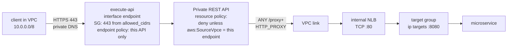

# Private API Gateway + VPC link + internal NLB (Terraform)

A reusable Terraform module for exposing an internal microservice through a
**private** API Gateway REST API. Clients inside the VPC call the API
through an `execute-api` interface endpoint; API Gateway reaches the
service through a VPC link to an internal Network Load Balancer. Nothing is
reachable from the internet.

> **Status:** `terraform validate` and 14 `terraform test` runs against a
> mocked AWS provider: two apply-with-mocks runs that check the wiring
> (private endpoint type, endpoint binding, VPC link to NLB, integration
> URI, resource policy, endpoint policy), four runs of the policy guard
> (one accepted policy; a policy with no endpoint condition, one using
> `aws:SourceVpc`, and one naming another endpoint are all rejected), one
> accepted set of private CIDRs, and seven rejected inputs. **Nothing has been
> planned or applied against AWS**, so real API Gateway behaviour (private
> DNS resolution, VPC link provisioning time, deployment ordering) is
> untested.

## Problem

> Create a reusable CloudFormation / Bicep / Terraform pattern for private
> API Gateway + VPC Link + NLB for internal microservices.

Terraform was chosen; CloudFormation and Bicep versions are not provided.

Why it matters: internal services often get a public API Gateway endpoint
because it is the default, and then rely on auth alone. A private API, an
endpoint policy and a resource policy that only accept calls from one VPC
endpoint take the internet out of the path entirely.

## Which API Gateway flavour, and why

This uses the **REST API** (API Gateway v1), not the HTTP API (v2):

- Only REST APIs have the `PRIVATE` endpoint type, which is what makes the
  API reachable solely through an `execute-api` VPC endpoint.
- REST APIs support a **resource policy**, used here to deny any call that
  does not come through this module's endpoint.
- The REST API VPC link (`aws_api_gateway_vpc_link`) targets **NLB ARNs**,
  which matches the brief.

The VPC link mechanics differ between the two flavours and have changed
over time. **Version-dependent, re-verify:** HTTP API VPC links (v2) are
built from subnets and security groups and can target ALBs, NLBs, or Cloud
Map; newer AWS releases also let REST APIs use v2-style VPC links to ALBs.
This module uses only the classic REST-to-NLB link. Check the AWS docs and
your provider version before switching.

## Request path



## Usage

```hcl
module "orders_api" {
  source = "github.com/zeinhaidara/40-terraform-private-api-gateway"

  name          = "orders"
  vpc_id        = "vpc-0aaaaaaaaaaaaaaa1"
  subnet_ids    = ["subnet-0aaaaaaaaaaaaaa01", "subnet-0aaaaaaaaaaaaaa02"]
  allowed_cidrs = ["10.0.0.0/8"]
  service_port  = 8080
  target_ips    = ["10.1.2.10", "10.1.3.10"]
}
```

`examples/basic` is the same call with placeholder IDs.

| Input | Default | Notes |
|---|---|---|
| `name` | required | 2-25 chars; NLB and target group names derive from it |
| `vpc_id` | required | |
| `subnet_ids` | required | private subnets for the NLB and the endpoint |
| `allowed_cidrs` | required | who may reach the endpoint on 443; must be inside private ranges |
| `service_port` | `8080` | port on the targets |
| `target_ips` | `[]` | optional IP targets; or register targets yourself via `nlb_target_group_arn` |
| `stage_name` | `v1` | |
| `tags` | `{}` | |

Outputs: `invoke_url`, `rest_api_id`, `vpc_endpoint_id`, `nlb_arn`,
`nlb_target_group_arn`.

### Run the checks locally (same as CI)

```bash
terraform fmt -check -recursive
terraform init -backend=false
terraform validate
terraform test

cd examples/basic
terraform init -backend=false -lockfile=readonly
terraform validate
```

CI installs Terraform 1.15.8 itself and checks the zip's sha256; it does not
use `setup-terraform`, so the wrapper setting does not apply. No CI step
parses Terraform output.

## Limits

- One `{proxy+}` route with `ANY`; requests to the bare root `/` are not
  routed. Add methods and resources for a richer API.
- No authorisation beyond the network path (`authorization = "NONE"`). The
  resource policy limits callers to the endpoint, and the endpoint SG limits
  source CIDRs. Add IAM auth (SigV4) if callers must be identified.
- The NLB listener is plain TCP on port 80 and the integration is HTTP; TLS
  ends at API Gateway. Add a TLS listener if traffic inside the VPC must be
  encrypted end to end.
- `private_dns_enabled = true` changes DNS for **all** `execute-api`
  hostnames in the VPC, which breaks calls from that VPC to other, public
  API Gateway APIs. Known AWS behaviour; re-verify for your setup.
- No access logging, WAF, throttling settings, or custom domain.
- Only one VPC endpoint is bound; endpoints in other VPCs are denied by the
  policy.

## Security notes

- No internet path: private API, internal NLB, interface endpoint.
- Three independent checks: the endpoint security group (who can reach the
  endpoint), the endpoint policy (the endpoint can only invoke this API, not
  any API in any account), and the resource policy `Deny` on
  `aws:SourceVpce` (which endpoint can call the API).
- The resource policy goes through `modules/policy-guard`, which fails the
  plan if the policy has no `Deny` on `execute-api:Invoke` for every
  endpoint except the module's own. Tests feed it bad policies directly.
- `allowed_cidrs` must sit inside private ranges (`10.0.0.0/8`,
  `172.16.0.0/12`, `192.168.0.0/16`, `100.64.0.0/10`); `0.0.0.0/0`, split
  ranges such as `0.0.0.0/1`, and public ranges are rejected. The security
  group has no egress rules.
- No credentials, state, or backend in the repo; IDs are placeholders.

## Idempotency

Declarative Terraform; re-applying with the same inputs is a no-op. The
deployment is re-created only when the route, method, integration or
policy changes (via a hash in `triggers`), and `create_before_destroy`
keeps the stage pointing at a live deployment during that swap.

## Versions

- Terraform `>= 1.9.0, < 2.0.0`; CI uses 1.15.8 (sha256 checked).
- `hashicorp/aws` `>= 6.0, < 7.0` in the module; the example pins `6.73.0`.
- `.terraform.lock.hcl` is committed only in `examples/basic`.
